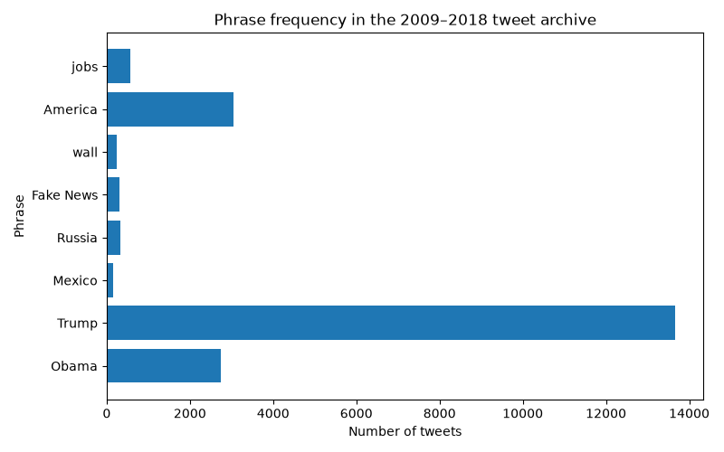

# [lab-web-data](https://csci40.rtealwitter.com/topics/05_web_scraping/lab.html)
| phrase            | percent of tweets |
| ----------------: | ----------------- |
|             Obama | 07.73             |
|             Trump | 38.58             |
|            Mexico | 00.45             |
|            Russia | 00.91             |
|         Fake News | 00.88             |
|              wall | 00.68             |
|           America | 08.58             |
|              jobs | 01.59             |

This dataset contains 35,402 tweets from 2009-2018. Trump appeared the most often, while America appeared the most often out of my 3 chosen phrases: wall, America, and jobs. I predicted that wall would appear the most often.